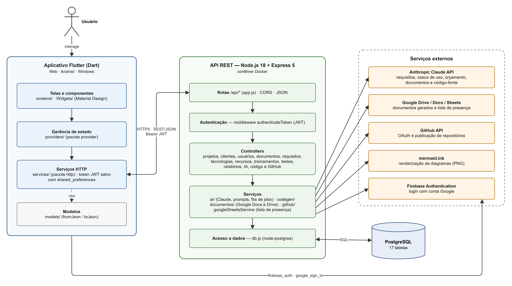
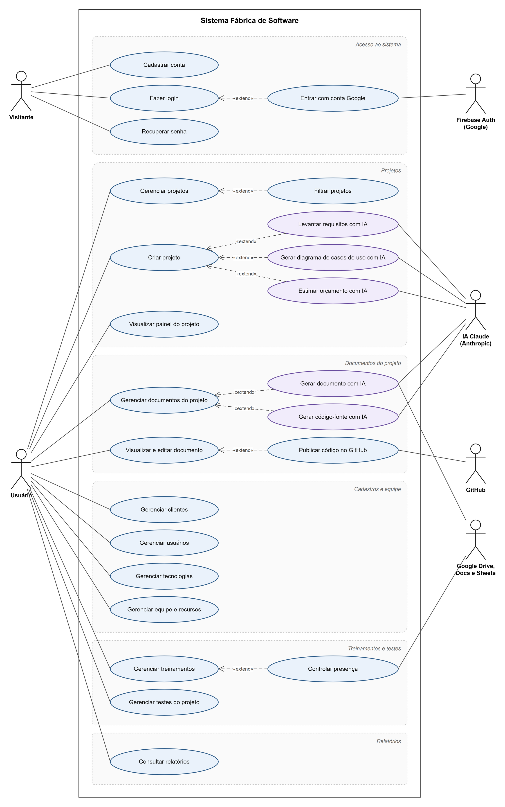
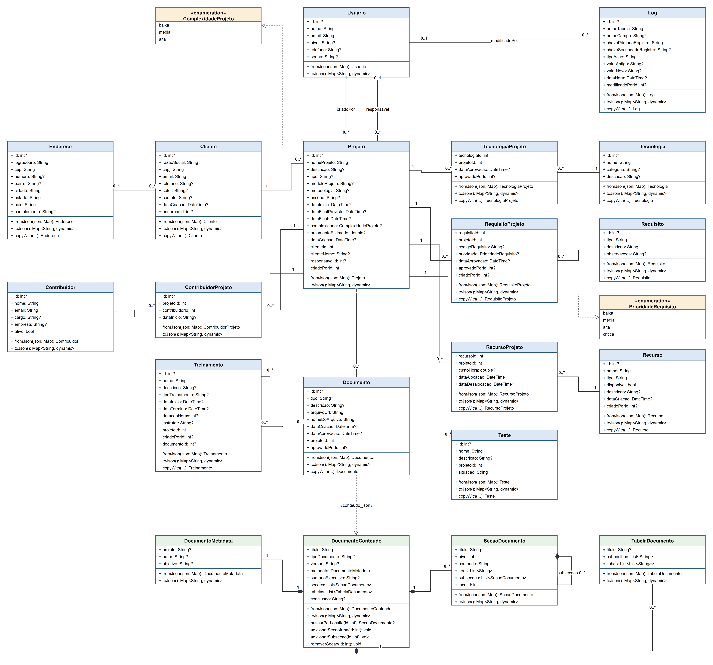
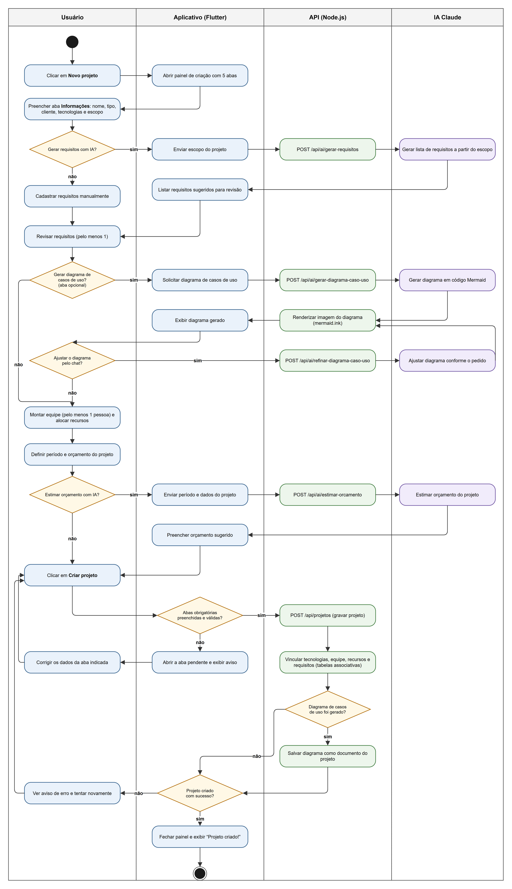

# Fábrica de Software — Frontend (aplicativo Flutter)

[](https://github.com/elronyjunior/FabricaDeSoftware-Frontend/actions/workflows/frontend-test.yml)
[](https://github.com/elronyjunior/FabricaDeSoftware-Frontend/actions/workflows/build.yml)
[](https://github.com/elronyjunior/FabricaDeSoftware-Frontend/actions/workflows/release.yml)

Aplicativo **Flutter** (web, Android e Windows) da plataforma **Fábrica de Software**: gestão de projetos de software com apoio de inteligência artificial para levantar requisitos, gerar diagramas, estimar orçamento, produzir documentação técnica e gerar/publicar o código-fonte do projeto no GitHub.

> A API (Node.js + PostgreSQL) que este app consome está em **[FabricaDeSoftware-Backend](https://github.com/elronyjunior/FabricaDeSoftware-Backend)**. Para o app funcionar localmente, a API precisa estar rodando.

---

## Sumário

1. [Contexto do projeto](#1-contexto-do-projeto)
2. [Arquitetura](#2-arquitetura)
3. [Tecnologias](#3-tecnologias)
4. [Telas e funcionalidades](#4-telas-e-funcionalidades)
5. [Requisitos funcionais (RF)](#5-requisitos-funcionais-rf)
6. [Requisitos não funcionais (RNF)](#6-requisitos-não-funcionais-rnf)
7. [Regras de negócio (RN)](#7-regras-de-negócio-rn)
8. [Diagramas](#8-diagramas)
9. [Estrutura de pastas](#9-estrutura-de-pastas)
10. [Como rodar localmente (passo a passo)](#10-como-rodar-localmente-passo-a-passo)
11. [Testes e qualidade](#11-testes-e-qualidade)
12. [Gerar os executáveis (build)](#12-gerar-os-executáveis-build)
13. [CI/CD — GitHub Actions](#13-cicd--github-actions)
14. [Problemas comuns](#14-problemas-comuns)

---

## 1. Contexto do projeto

Uma **fábrica de software** recebe pedidos de vários clientes e precisa, para cada projeto, levantar requisitos, montar a equipe, alocar recursos, estimar prazo e orçamento, produzir a documentação (especificação, casos de uso, arquitetura, modelagem, plano de testes…), treinar o cliente e acompanhar os testes. Esse trabalho costuma ficar espalhado em planilhas, documentos soltos e conversas.

A **Fábrica de Software** centraliza esse ciclo numa única plataforma e usa IA generativa (Claude, da Anthropic) para acelerar as etapas mais trabalhosas:

| Etapa do ciclo | O que a plataforma faz |
| --- | --- |
| Cadastro | Clientes (com endereço e mapa), usuários, tecnologias, contribuidores (equipe) e recursos. |
| Criação do projeto | Assistente em 5 abas: informações, requisitos, casos de uso, equipe e recursos, planejamento. |
| Requisitos | A IA sugere os requisitos a partir do escopo descrito; o usuário revisa e pode conversar com a IA para ajustar. |
| Casos de uso | A IA gera o diagrama de casos de uso e ajusta pelo chat. |
| Orçamento | A IA estima o orçamento a partir do período, da equipe e da complexidade. |
| Documentação | A IA gera documentos técnicos completos, que podem ser editados por seção dentro do app (inclusive pedindo à IA para reescrever seções) e exportados em PDF. |
| Código-fonte | A IA gera o código do projeto em camadas e o app publica num repositório novo do GitHub do usuário. |
| Treinamentos e testes | Treinamentos do projeto com controle de presença e acompanhamento dos testes. |
| Gestão | Painel do projeto e relatórios com gráficos. |

**Público-alvo:** gestores e equipes de uma fábrica de software (gerentes de projeto, analistas e desenvolvedores).

**Este repositório** contém o aplicativo: telas, navegação, gerência de estado e a comunicação com a API.

---

## 2. Arquitetura



O app é organizado em camadas:

| Camada | Pasta | Responsabilidade |
| --- | --- | --- |
| Telas e componentes | `lib/screens/`, `lib/Widgets/` | Interface (Material Design, identidade visual própria, layout com menu lateral). |
| Gerência de estado | `lib/providers/` | Estado das telas com o pacote `provider` (`ChangeNotifier`). |
| Serviços | `lib/services/` | Chamadas HTTP à API (`http`), token JWT salvo com `shared_preferences`, geração de PDF. |
| Modelos | `lib/models/` | Classes de domínio com `fromJson`/`toJson` (diagrama de classes na seção 8). |
| Configuração | `lib/config/`, `lib/utils/` | Endereço da API, utilitários (mensagens de erro, abertura de links, polling de jobs). |

A autenticação usa **JWT** emitido pela API (login com e-mail/senha) ou **Firebase Authentication** (login com Google, que depois troca o token do Google por um JWT da API).

---

## 3. Tecnologias

| Item | Tecnologia | Versão |
| --- | --- | --- |
| Framework | Flutter | **3.35.7** (a mesma do CI) |
| Linguagem | Dart | 3.9 |
| Estado | provider | 6 |
| HTTP | http | 1.x |
| Autenticação | firebase_core, firebase_auth, google_sign_in | — |
| Armazenamento local | shared_preferences | — |
| Gráficos | fl_chart | — |
| PDF | pdf, printing | — |
| Interface | google_fonts, font_awesome_flutter, flutter_svg | — |
| Testes | flutter_test | — |
| CI/CD | GitHub Actions + Dependabot | — |

Plataformas: **Web** (Chrome/Edge), **Android** e **Windows**.

---

## 4. Telas e funcionalidades

| Tela | O que faz |
| --- | --- |
| Login / Cadastro / Recuperar senha | Entrada com e-mail e senha ou conta Google; criação de conta. |
| Gerenciar projetos | Lista de projetos em cards, filtros e botão **Novo projeto**. |
| Novo projeto (5 abas) | Informações · Requisitos (com IA) · Casos de uso (com IA, opcional) · Equipe e recursos · Planejamento (orçamento com IA). |
| Painel do projeto | Detalhes, orçamento, equipe, requisitos e atalhos para documentos, treinamentos e testes. |
| Documentos do projeto | Lista, criação de documentos com IA e geração de código-fonte com IA. |
| Editor de documento | Edição por seções, reescrita de seções com IA, revisão das alterações, exportação em PDF; para código-fonte, visualizador de arquivos e publicação no GitHub. |
| Clientes | Cadastro de clientes com endereço (busca por CEP e mapa). |
| Equipe | Contribuidores e alocação nos projetos. |
| Recursos / Tecnologias / Usuários | Cadastros gerais. |
| Treinamentos | Treinamentos do projeto e controle de presença. |
| Testes | Testes do projeto e sua situação. |
| Relatórios | Indicadores e gráficos dos projetos. |

---

## 5. Requisitos funcionais (RF)

| ID | Requisito | Onde |
| --- | --- | --- |
| RF01 | Cadastrar conta (nome, e-mail, senha, telefone) | Tela de cadastro |
| RF02 | Fazer login com e-mail e senha | Tela de login |
| RF03 | Fazer login com conta Google | Tela de login |
| RF04 | Recuperar senha — **parcial**: a tela existe; o envio por e-mail depende de uma rota que a API ainda não tem | Recuperar senha |
| RF05 | Gerenciar usuários e níveis de acesso | Usuários |
| RF06 | Gerenciar clientes e endereços (com busca por CEP e mapa) | Clientes |
| RF07 | Listar, filtrar, editar e excluir projetos e ver o painel do projeto | Gerenciar projetos |
| RF08 | Criar projeto em etapas (5 abas) gravando todos os vínculos | Novo projeto |
| RF09 | Gerar requisitos com IA a partir do escopo e refiná-los por chat | Novo projeto → Requisitos |
| RF10 | Gerar o diagrama de casos de uso com IA e ajustá-lo por chat | Novo projeto → Casos de uso |
| RF11 | Estimar o orçamento do projeto com IA | Novo projeto → Planejamento |
| RF12 | Gerenciar tecnologias e vinculá-las ao projeto | Tecnologias / Novo projeto |
| RF13 | Gerenciar contribuidores e alocá-los no projeto | Equipe / Novo projeto |
| RF14 | Gerenciar recursos e alocá-los no projeto | Recursos / Novo projeto |
| RF15 | Gerar documentos técnicos com IA | Documentos do projeto |
| RF16 | Editar o documento por seções, reescrever seções com IA e exportar em PDF | Editor de documento |
| RF17 | Gerar o código-fonte do projeto com IA e acompanhar o progresso | Documentos do projeto |
| RF18 | Conectar o GitHub e publicar o código gerado num repositório novo | Editor (código-fonte) |
| RF19 | Gerenciar treinamentos e controlar a presença | Treinamentos |
| RF20 | Gerenciar os testes do projeto | Testes |
| RF21 | Consultar relatórios com gráficos | Relatórios |

---

## 6. Requisitos não funcionais (RNF)

| ID | Categoria | Requisito |
| --- | --- | --- |
| RNF01 | Portabilidade | Um único código-fonte gera o app para web, Android e Windows. |
| RNF02 | Usabilidade | Identidade visual própria, menu lateral fixo em telas largas (≥ 900 px) e diálogos sobre a tela inteira; layout responsivo para telas estreitas. |
| RNF03 | Usabilidade | O formulário de novo projeto valida as abas obrigatórias e leva o usuário direto para a aba com pendência. |
| RNF04 | Segurança | Toda chamada à API (exceto login/cadastro) envia o token JWT; o token do GitHub nunca chega ao app (fica cifrado no servidor). |
| RNF05 | Desempenho | Operações longas de IA são acompanhadas por *polling* do status do job, com cancelamento quando o usuário fecha a tela. |
| RNF06 | Confiabilidade | Respostas da API e da IA são lidas de forma tolerante (JSON inesperado não derruba a tela) e erros viram mensagens claras. |
| RNF07 | Testabilidade | Testes de unidade e de widgets (`flutter test`) com HTTP simulado, executados a cada push e pull request. |
| RNF08 | Manutenibilidade | Camadas separadas (telas → providers → serviços → modelos); análise estática com `flutter analyze`; dependências atualizadas pelo Dependabot. |
| RNF09 | Compatibilidade | Versão do Flutter fixada em 3.35.7 no CI e no passo a passo, para todos compilarem igual. |

---

## 7. Regras de negócio (RN)

| ID | Regra |
| --- | --- |
| RN01 | Todo projeto pertence a um cliente e é criado pelo usuário logado. |
| RN02 | Para concluir um projeto novo são obrigatórios: nome, tipo e cliente; pelo menos 1 requisito; pelo menos 1 pessoa na equipe; período e orçamento maior que zero. A aba de casos de uso é opcional. |
| RN03 | Se a aba de casos de uso gerou um diagrama, ele é salvo como documento do projeto ao concluir a criação. |
| RN04 | Excluir um documento de código-fonte não apaga o repositório já publicado no GitHub. |

---

## 8. Diagramas

Os diagramas estão em [`docs/diagramas/`](docs/diagramas) em PNG, [draw.io](docs/diagramas/drawio) (editável no [draw.io Desktop](https://github.com/jgraph/drawio-desktop/releases) ou em [app.diagrams.net](https://app.diagrams.net)) e [Mermaid](docs/diagramas/mermaid) (texto, abre em [mermaid.live](https://mermaid.live)).

### Casos de uso


### Diagrama de classes (modelos de `lib/models`)


### Diagrama de atividades — criação de projeto


Os modelos conceitual e lógico do banco de dados (draw.io e brModelo) estão no repositório do [backend](https://github.com/elronyjunior/FabricaDeSoftware-Backend).

---

## 9. Estrutura de pastas

```
FabricaDeSoftware-Frontend/
├── lib/
│   ├── main.dart                 # Ponto de entrada, rotas e Firebase
│   ├── firebase_options.dart     # Configuração do Firebase por plataforma
│   ├── config/                   # Endereço da API e DTO do projeto
│   ├── models/                   # Classes de domínio (fromJson/toJson)
│   ├── providers/                # Gerência de estado (provider)
│   ├── services/                 # Chamadas à API, autenticação, PDF
│   ├── screens/                  # Uma pasta por tela
│   ├── Widgets/                  # Layout principal, menu, modal de criação de projeto
│   └── utils/                    # Utilitários
├── test/                         # Testes de unidade e de widgets
├── assets/                       # Imagens e ícones
├── android/ ios/ web/ windows/ linux/ macos/
├── docs/diagramas/               # Diagramas (PNG, draw.io, Mermaid)
├── .github/                      # Workflows do GitHub Actions e Dependabot
└── pubspec.yaml                  # Dependências
```

---

## 10. Como rodar localmente (passo a passo)

### 10.1 Pré-requisitos

| Ferramenta | Versão | Observação |
| --- | --- | --- |
| [Git](https://git-scm.com/) | recente | — |
| [Flutter SDK](https://docs.flutter.dev/get-started/install) | **3.35.7** | Versões mais novas (ex.: 3.47) quebram o pacote `font_awesome_flutter` usado no projeto. |
| Google Chrome ou Edge | recente | Para rodar a versão web. |
| [Android Studio](https://developer.android.com/studio) + emulador | opcional | Para rodar no Android. |
| [Visual Studio](https://visualstudio.microsoft.com/) com "Desenvolvimento para desktop com C++" | opcional | Para rodar no Windows. |
| A API rodando | — | Siga o passo a passo do [backend](https://github.com/elronyjunior/FabricaDeSoftware-Backend#9-como-rodar-localmente-passo-a-passo). |

### 10.2 Instalar a versão certa do Flutter

Se você já tem o Flutter instalado via Git, troque para a versão do projeto:

```bash
cd <pasta-do-flutter>
git fetch --tags
git checkout 3.35.7
flutter --version
```

> Dica: com o [FVM](https://fvm.app) cada projeto usa sua própria versão: `fvm install 3.35.7` e depois `fvm use 3.35.7` dentro desta pasta (aí os comandos viram `fvm flutter ...`).

Confira o ambiente:

```bash
flutter doctor
```

### 10.3 Clonar e instalar as dependências

```bash
git clone https://github.com/elronyjunior/FabricaDeSoftware-Frontend.git
cd FabricaDeSoftware-Frontend
flutter pub get
```

### 10.4 Apontar para a API

Por padrão o app chama `http://localhost:3000/api`, que é onde a API sobe localmente. Se a API estiver em outro endereço, altere a constante `baseUrl` nestes três arquivos:

- `lib/config/api_config.dart`
- `lib/services/api_config.dart`
- `lib/utils/api_constants.dart`

> **Emulador Android:** dentro do emulador, `localhost` é o próprio celular. Use `http://10.0.2.2:3000/api`.

### 10.5 Rodar

```bash
flutter devices              # lista onde dá para rodar
flutter run -d chrome        # web (Chrome)
flutter run -d edge          # web (Edge)
flutter run -d windows       # Windows
flutter run -d emulator-5554 # Android (o id aparece no flutter devices)
```

Faça login com o usuário criado no passo a passo do backend (seção 9.7 de lá) ou crie uma conta pela tela de cadastro.

> O login com Google na web usa o Firebase do projeto. Se for usar outro projeto Firebase, gere de novo o `lib/firebase_options.dart` com `flutterfire configure` e ponha o `google-services.json` em `android/app/`.

---

## 11. Testes e qualidade

```bash
flutter test               # todos os testes
flutter test --coverage    # idem, gera coverage/lcov.info
flutter analyze            # análise estática
```

Os testes não precisam da API: as chamadas HTTP são simuladas. O número de testes e a cobertura atualizados aparecem no resumo de cada execução do workflow **Frontend Tests** (aba *Actions*).

---

## 12. Gerar os executáveis (build)

```bash
flutter build web --release   # site em build/web
flutter build apk --release   # APK em build/app/outputs/flutter-apk/app-release.apk
flutter build windows         # executável em build/windows/x64/runner/Release
```

> O APK de release está assinado com a chave de debug (configuração padrão em `android/app/build.gradle.kts`). Para publicar na Play Store é preciso configurar uma chave de assinatura própria.

---

## 13. CI/CD — GitHub Actions

| Workflow | Quando roda | O que faz |
| --- | --- | --- |
| [`frontend-test.yml`](.github/workflows/frontend-test.yml) | push e PR em `main`/`develop`, manual | Instala o Flutter 3.35.7, roda `flutter analyze` e `flutter test --coverage`; publica o resumo da cobertura na página da execução e o `lcov.info` como artefato. |
| [`build.yml`](.github/workflows/build.yml) | push e PR em `main`/`develop`, manual | Compila para **web** e **Android (APK)** em paralelo e deixa o site e o APK para download na página da execução. |
| [`release.yml`](.github/workflows/release.yml) | ao criar uma tag `v*` (ex.: `v1.4.0`), manual | Roda os testes, compila web e APK e cria um **Release** no GitHub com o APK e o site em `.zip` anexados, com notas geradas automaticamente. |
| [`dependabot.yml`](.github/dependabot.yml) | semanal | Abre PRs atualizando os pacotes do `pubspec.yaml` e as versões das Actions. |

Para publicar uma versão:

```bash
git tag v1.4.0
git push origin v1.4.0
```

Boas práticas aplicadas: versão do Flutter fixada, cache do SDK, cancelamento de execuções antigas do mesmo branch (`concurrency`), disparo manual (`workflow_dispatch`) e artefatos com prazo de retenção.

---

## 14. Problemas comuns

| Sintoma | Causa e solução |
| --- | --- |
| `The class 'IconData' can't be extended outside of its library` | Flutter mais novo que o do projeto. Use o **3.35.7** (seção 10.2). |
| `Because fabrica_software_app depends on google_fonts ... requires SDK version >=3.9.0` | Flutter mais antigo que o do projeto. Use o **3.35.7**. |
| Login não funciona / `Connection refused` | A API não está rodando ou o `baseUrl` está errado (seção 10.4). |
| No emulador Android não conecta na API | Use `10.0.2.2` no lugar de `localhost`. |
| `flutter run -d windows` falha | Falta o Visual Studio com a carga "Desenvolvimento para desktop com C++" (`flutter doctor` mostra). |
| Login com Google abre e fecha na web | O domínio precisa estar autorizado no Firebase (*Authentication → Settings → Authorized domains*); `localhost` já vem autorizado. |
